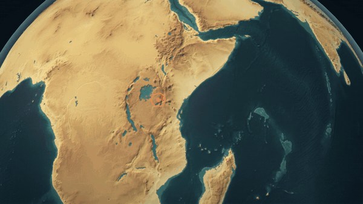
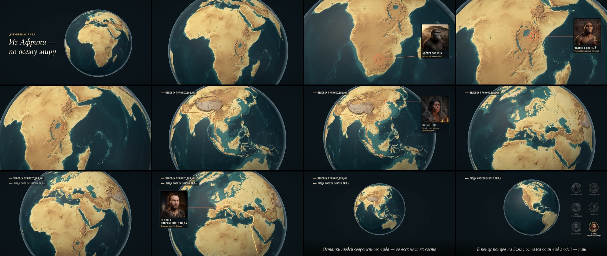
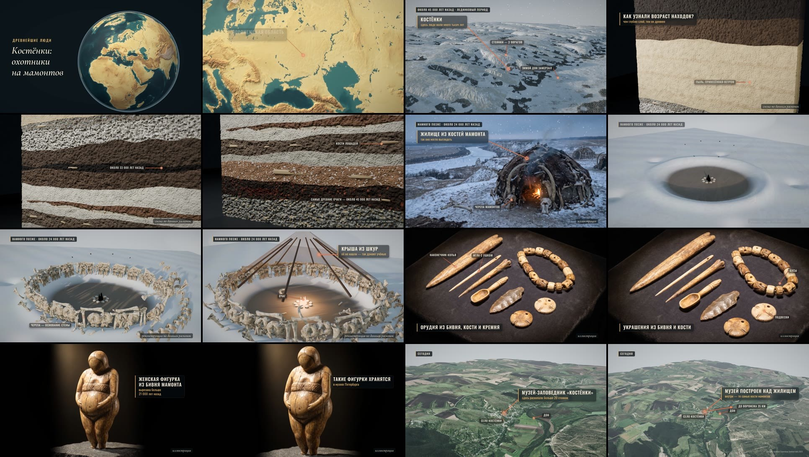
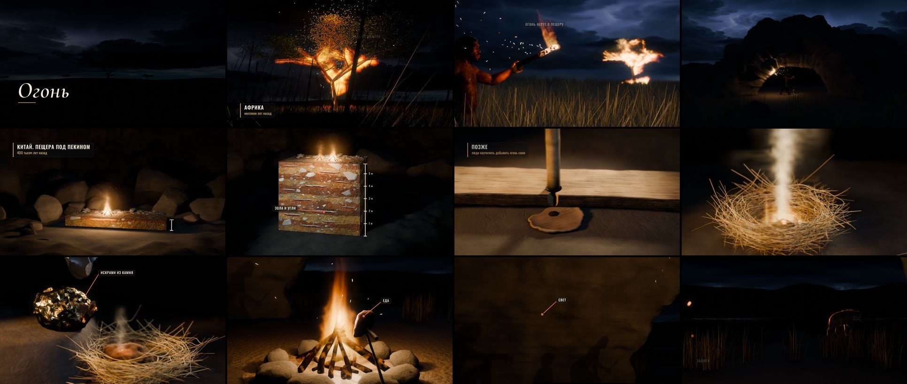
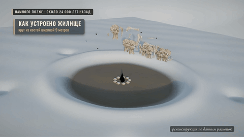
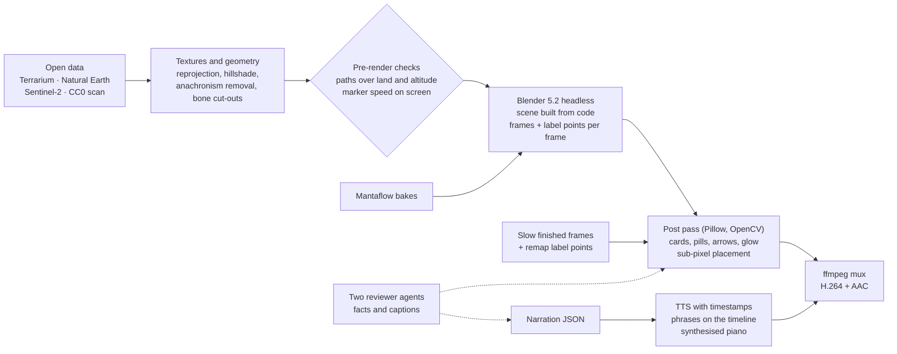
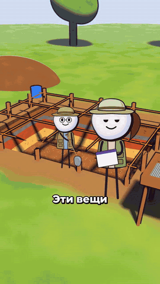

# Open-Data Documentary Clips in Headless Blender

**Three narrated documentary clips for 5th-grade history lessons, 1 to 2 minutes each, generated from Python in Blender 5.2 (headless EEVEE and Cycles) out of open data: real Earth relief, Copernicus Sentinel-2 imagery and a CC0 Smithsonian scan of a mammoth skeleton, plus a few AI-generated stills (Higgsfield) used as species cards and animated as depth layers. No AI video: every camera move, bone and flame is code, every fact and caption went through two reviewers, and two of the clips have been playing inside a production lesson since 2026-11-11.**



*Clip 01, 25-37 s: real elevation (AWS Terrarium, 8192x4096), paths checked against land and altitude before rendering, species cards drawn in a separate sub-pixel pass. The lesson content is in Russian; code, comments and docs are in English.*

| | |
|---|---|
| **Clips** | 01 Out of Africa, 69 s, 2070 frames at 30 fps · 02 Kostenki: mammoth hunters, 1:56, 3486 frames at 30 fps · 03 Fire, 70.8 s, 9 shots, 1699 frames at 24 fps (all 1920x1080) |
| **Open data** | AWS Terrarium elevation (Mapzen), Natural Earth lakes, Copernicus Sentinel-2 L2A via the Element84 STAC, Smithsonian NMNH woolly mammoth scan (CC0) |
| **Scale** | globe relief 8192x4096 · valley 43x43 km with a 14x14 km detail patch on an 8 m grid · ~250k instanced Ice Age trees · 7168x7168 valley textures · 17-layer excavation section |
| **Render** | clip 01 ~1.5 s/frame (about 50 min for 2070 frames); clip 03 1815 frames in ~2 h in one queue; RTX 3060, no cloud and no per-minute video credits |
| **Iteration** | clip 01 went through 5 reviewed versions; captions were re-timed by slowing finished frames instead of re-rendering |
| **Stack** | Blender 5.2 `bpy` (bmesh, geometry nodes, Mantaflow, EEVEE/Cycles), numpy, SciPy, OpenCV, Pillow, rasterio, ffmpeg, Node.js (ElevenLabs TTS with timestamps) |
| **Code** | 62 clip scripts, 6,891 lines + shared `lib/`, tools and tests, 1,137 lines, + `run.sh` and `Makefile` (measured on 2026-11-20 in this repo). The production folders held 2,888 / 2,924 / 4,432 lines in 21 / 33 / 37 files, including superseded versions and one-off patches that are not published |
| **Tests** | 119 offline tests (one is skipped until `./run.sh 01 fetch` and `textures` have built the relief), no Blender or network: every script compiles, reprojection maths, path checks, caption timing, timeline consistency, text overlap check, the keyless music-only voice stage (measured on 2026-11-20 in this repo) |
| **In production** | clips 01 and 02 play inside the lesson "The earliest humans" of an AI-first EdTech platform for school lessons, live in production; clip 03 is finished and not yet in a lesson |

---

## The three clips

| | | |
|---|---|---|
| [](docs/media/previews/01-out-of-africa-preview.mp4) | [](docs/media/previews/02-kostenki-preview.mp4) | [](docs/media/previews/03-fire-preview.mp4) |
| **01 Out of Africa.** A globe with real relief and lakes; six find sites with species cards; Homo erectus to Java and China, Neanderthals in Europe, modern humans out of Africa to every continent. [25 s preview](docs/media/previews/01-out-of-africa-preview.mp4) | **02 Kostenki.** The Don valley in the Ice Age and today from real relief and Sentinel-2; a 17-layer section; a dwelling assembled from the bones of a CC0 museum scan; finds; the museum built over the dwelling. [30 s preview](docs/media/previews/02-kostenki-preview.mp4) | **03 Fire.** Lightning sets a tree alight, fire is carried into a cave, a 6 m layer with ash and charcoal builds up in a cave section near Beijing, fire by friction and by flint on pyrite, a campfire that keeps a hyena away. [25 s preview](docs/media/previews/03-fire-preview.mp4) |

Full-length clips are release assets (20, 28 and 26 MB): see [docs/RELEASE_ASSETS.md](docs/RELEASE_ASSETS.md).
English translations of everything the narrator says are in `clips/*/data/narration.en.md`.



*Clip 02, scene H: skulls, mandibles, tusks and long bones cut from the 2.9 GB museum-scan OBJ, decimated and placed by rules from the excavation brief (a ~9 m ring, skull pairs as the wall base, long bones as posts).*

## How it works



1. **Data is downloaded at build time**, never committed: elevation tiles, lakes, a Sentinel-2 scene read over HTTP range requests, the museum scan. Re-running the fetch scripts on 2026-11-20 rebuilt both elevation grids bit for bit identical to the ones used for the production renders.
2. **Scenes are pure Python** on top of `blender -b --factory-startup`: no `.blend` files, so every scene is diffable and reproducible.
3. **Every scene writes frames and, separately, the screen position of every label point per frame.** Text never goes into the render.
4. **The post pass** draws cards, captions and arrows on the frames, so wording and timing change without re-rendering.
5. **Narration** comes from a JSON script with stress marks; TTS returns per-character timestamps that drive card timing.
6. **ffmpeg** muxes a master, a light copy and a web version.

Details per step: [docs/PIPELINE.md](docs/PIPELINE.md).

## Engineering decisions

- **Real data and code instead of AI video.** AI video was rejected for these lessons as too expensive (135-420 credits per minute of footage). A globe from real relief and a valley from a real satellite image are geographically right by construction, render locally on one GPU at no per-minute cost, and a review note is usually fixed by editing a number.
- **Check before the 50-minute render.** `proverka_putey.py` smooths each migration path exactly like the scene does and samples elevation and the ocean mask along it; `analiz.py` reads the exported label points and reports how fast each labelled marker moves on screen (kept to ~40-60 px/s while a caption is visible). One defect slipped through the first check (a raised arc looked as if it crossed the sea under an oblique camera), so the arcs were lowered and frames are now inspected as well. The check is in `lib/paths.py` with tests.
- **Text is a separate pass.** Scenes export `world_to_camera_view` positions per frame; Pillow and OpenCV draw labels with sub-pixel placement because whole-pixel steps made the early labels tremble. Caption and card changes, including the switch to fixed species cards in the fifth version of clip 01, were made in this pass without re-rendering.
- **Re-time instead of re-render.** When reviewers wanted more reading time, finished frames were slowed with motion-compensated interpolation and the label points remapped with the same time function: the section went from 15 to 23 s, the dwelling from 16 to 20 s, the figurine from 14 to 16.8 s. A test checks that these numbers agree with the edit.
- **An Ice Age from a 2025 satellite image.** Only nature is taken from the Sentinel-2 scene: the Don channel as the largest connected body of class-6 water, chalk outcrops, woods on gully floors. Fields, villages, roads and the reservoir are anachronisms and are dropped; the relief is cleaned of embankments and shelter belts with grey opening/closing. A tempting shortcut (subtracting tree canopy with a green mask) was rejected because it also caught fields and left steps along their borders.
- **A museum scan taken apart.** The 2.9 GB OBJ is streamed into numpy in chunks, "X-rayed" in three projections to find each bone, split into connected pieces, cut by boxes and decimated in Blender. The dwelling is then assembled by rules, with the unfound roof drawn semi-transparent as "what scientists think".
- **Fire that never blinks.** Baked Mantaflow fires are reused as seamless loops (two volumes half a period apart with crossfaded emission); in the cave section the campfires relay, so at least one burns at full strength at any moment (checked by calculation) and flame is present in all 336 frames of the shot; EEVEE's sliced-volume hatching on the burning tree is removed in post by averaging brightness only between fire pixels.
- **Deterministic, resumable rendering.** Scene state is a function of the frame number, finished frames are skipped, and clip 03 renders one shot at a time at low priority so the machine stays usable.

## Fact-checking

Every narrated sentence and caption was reviewed by two agents (a historian and an editor or methodologist) before the render; I accepted or rejected each note. Examples: paths to China go through Vietnam rather than across Tibet; "the Don froze in winter", not "under ice"; the hide roof is labelled as a hypothesis; "a layer with ash and charcoal, six metres", not "six metres of ash"; sparks come from flint on pyrite, not flint on flint. Every Russian text in this repository was also checked against school textbook corpora kept outside it: no shared run of 8 or more words (`tools/overlap_check.py`). Full list: [docs/FACT_CHECK.md](docs/FACT_CHECK.md).

## A contrasting approach: AI toon-3D



Two other short clips for the same course (Herodotus, 57 s, and archaeology, 51 s, both 720x1280) were made with Higgsfield as toon-3D characters in 3D sets. That route is fast for a story with characters but gives much less control over geography, scale and exact geometry, and every minute costs credits. The Blender clips trade speed of the first draft for correctness and cheap revisions. *(Three silent seconds, AI-generated with Higgsfield.)*

## Run it

Tested with Python 3.14 (3.14.2, Windows with Git Bash). Tests need neither Blender nor network:

```bash
python -m venv .venv && .venv/Scripts/activate      # macOS/Linux: source .venv/bin/activate
pip install -r requirements-dev.txt
python -m pytest -q                                 # 119 tests: 118 pass, 1 is skipped until `./run.sh 01 fetch` and `textures` have run
```

A real render needs Blender 5.2 and `pip install -r requirements.txt` (every pin, rasterio 1.5.2 included, installs from a binary wheel on Python 3.14; checked on Windows on 2026-11-20):

```bash
export BLENDER="/path/to/blender"                   # Blender 5.2
make smoke                                          # clip 01: download open data, textures, path check, 3 frames + label pass
./run.sh 01 all --preview                           # whole clip at half resolution; without ElevenLabs keys the track is music only
./run.sh 01 all                                     # full 1080p; narration needs ELEVENLABS_API_KEY and ELEVENLABS_VOICE_ID (.env.example)
./run.sh help                                       # every stage of every clip
```

`make smoke` needs no keys and is the quickest demo. It was run on 2026-11-20 in this repo on Blender 5.2.3 LTS: the three frames and their labels match the production frames ([comparison](docs/media/smoke-vs-production.jpg): top row is the smoke run from this repo, bottom row is the same frames of the production render; rebuilt by `tools/smoke_compare.py`).

## Repository layout

```
clips/01-out-of-africa/   scripts/ (globe: relief, textures, path check, scene, post, audio, mux)
                          data/ (narration ru/en + JSON, word timings, path waypoints, species portraits)
clips/02-kostenki/        scripts/ (relief, Sentinel-2, valley, detail + trees, section, scan -> bones, dwelling, edit)
                          data/ (narration ru/en + JSON, label points)
clips/03-fire/            scripts/ (Mantaflow bakes, shared helpers, 5 scene scripts, render queue, edit, audio)
                          data/ (narration ru/en + JSON)
lib/                      geo.py, paths.py, captions.py, textcheck.py (tested, Blender-free), narration.mjs, muzyka.py
tools/                    overlap_check.py (text vs. local corpora), make_media.sh (docs media from release assets),
                          smoke_compare.py (labelled smoke-vs-production image)
tests/                    offline tests
assets/fonts/             Oswald, Cormorant Garamond (SIL OFL 1.1)
docs/                     PIPELINE.md, FACT_CHECK.md, RELEASE_ASSETS.md, GLOSSARY.md, media/
run.sh, Makefile          one entry point for every stage, --preview half-resolution mode
```

File names and identifiers are transliterated Russian (`scena`, `dolina`, `razrez`); [docs/GLOSSARY.md](docs/GLOSSARY.md) maps them.

## Status

- Clips 01 and 02 are finished and play inside a production lesson since 2026-11-11; clip 03 is finished (v3, 2026-11-18) and waits for its lesson.
- The scripts are the production scripts, with comments translated, local paths replaced by arguments and environment variables, and the voice client merged into one `lib/narration.mjs`. One-off patch scripts and superseded versions were left out.
- Fully reproducible from this repository: clip 01 and the open-data scenes of clip 02 (globe, valleys, section, and the dwelling once the scan is downloaded). Scenes built on AI pictures (clip 02 C, D1, D2; parts of clip 03) need those pictures, which are not included. Narration needs an ElevenLabs key (without it `run.sh` gives clips 01 and 02 a music-only track and stops clip 03 at its voice stage); its text and measured timings are in `data/`.
- Rendering is GPU-heavy; there is no CI render, only the offline tests and the documented smoke run.
- Next clips are designed, not built: an Ice Age hunt, Altamira, Onega petroglyphs, a Neolithic valley timelapse and the Nile flood, under the same review rules.

## Credits and licenses

- **Elevation:** Mapzen Terrain Tiles on the AWS Registry of Open Data (Terrarium encoding), built from SRTM, GMTED, ETOPO1 and other open sources; see the [terrain tiles attribution](https://github.com/tilezen/joerd/blob/master/docs/attribution.md).
- **Lakes:** Natural Earth 1:10m lakes, public domain.
- **Satellite imagery:** Contains modified Copernicus Sentinel data 2025 (Sentinel-2 L2A via the Element84 Earth Search STAC on AWS).
- **Mammoth skeleton:** Smithsonian National Museum of Natural History woolly mammoth 3D scan, released CC0 through Smithsonian Open Access.
- **Fonts:** Oswald (The Oswald Project Authors) and Cormorant Garamond (The Cormorant Project Authors), SIL Open Font License 1.1, see `assets/fonts/OFL.txt`.
- **Voice:** ElevenLabs (narration and sound effects in the released clips).
- **Images:** species portraits (clip 01), layered pictures (clip 02), sky, hyena and figure cards (clip 03) and the toon-3D excerpt: AI-generated with Higgsfield.
- **Software:** Blender, ffmpeg, numpy, SciPy, OpenCV, Pillow, rasterio.

Code was written AI-first with Claude Code; architecture, decisions and acceptance are mine.

## License

Code: MIT, see [LICENSE](LICENSE). Data, fonts, voice and AI-generated media keep the licenses and terms listed above.
