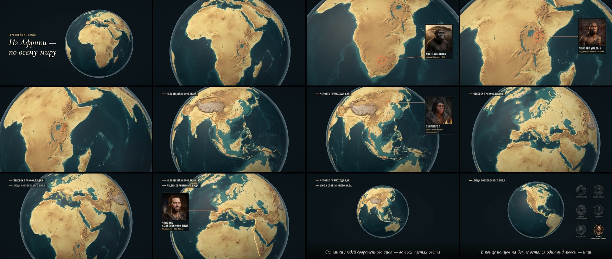

# 01 Out of Africa

A 69-second globe (1920x1080, 30 fps, 2070 frames) for the lesson "The earliest humans": the ancestral home in Africa,
six find sites with species cards, the spread of Homo erectus to Java and China, Neanderthals in Europe, and modern
humans out of Africa to every continent.

| Step | Script | Notes |
|---|---|---|
| data | `rel_ef.py`, `fetch_lakes.py` | Terrarium z5 -> 8192x4096 metres; Natural Earth lakes |
| textures | `tekstury.py` | colour with hillshade (sun from the north-west, 14x relief exaggeration), 16-bit heights, ocean mask; lakes are water even above sea level |
| check | `proverka_putey.py`, `data/puti.json` | waypoints of the 5 paths; the check reports every stretch over water and above a 2500 m threshold and does not block the render. Short stretches remain (measured on 2026-11-20 in this repo): above 2500 m in the East African highlands (up to 2917 m), on Lombok, in the Zagros and in Alaska; over water at the Malacca and Sunda straits, across Wallacea and the Timor Sea, at the Bering Strait, and short coastal cuts off Panama and Venezuela |
| scene + render | `scena.py` | custom UV sphere, displacement, atmosphere rim, camera on a pivot with 24 keys, animated arcs and markers; writes `metki.json` |
| analysis | `analiz.py` | on-screen speed of labelled markers and path heads, disc radius |
| post | `post.py` | glow, fixed species cards with sub-pixel leader lines, legend, titles, final row of species |
| audio | `lib/narration.mjs`, `lib/muzyka.py`, `dorozhka.py` | 8 phrases, piano bed, -16 LUFS voice |
| mux | `sobrat.sh` | 4 parallel post workers + ffmpeg |

`data/portraits/` holds the six species portraits (AI-generated with Higgsfield) at card size. `fon_portreta.py` is the
optional tool that put one of them on a new background without regenerating it.

Run: `./run.sh 01 all` (or `--preview`), or step by step, see `./run.sh help`.
