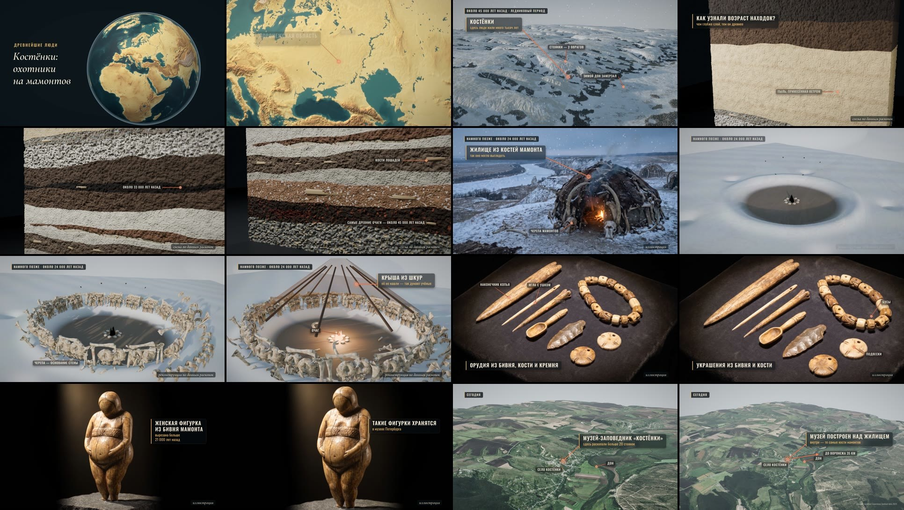

# 02 Kostenki: mammoth hunters

A 1:56 clip (1920x1080, 30 fps, 3486 frames) in eight scenes: the globe flies to the Don (A), the Ice Age valley at
dusk (B), the excavation section (S), a reconstructed camp picture (C), the mammoth-bone dwelling assembling (H), tools
and ornaments (D1), the Venus figurine (D2), and the valley today from the satellite image (E).

| Scene | Script | Built from |
|---|---|---|
| A | `globus.py` | the clip 01 globe textures (`GLOBE_TEX`) |
| B, E | `dolina.py led / leto` | Terrarium z12 relief (`fetch_don_relief.py`), Sentinel-2 true colour and scene classes (`sputnik.py`), colour maps (`tekstury2.py`), detail patch and trees (`detal.py`) |
| S | `razrez.py` | 17 schematic layers (`razrez_dannye.py`), finds, an SDF femur (`kosti.py`) |
| H | `zhilishche.py` | bones cut from the Smithsonian CC0 scan (`skan_razbor.py` -> `skan_kosti.py` -> `skan_oblegchit.py`) and SDF bones |
| C, D1, D2 | `sloi.py` -> `proekciya2.py` | Higgsfield pictures split into depth layers (not in this repository) |
| edit | `montazh2.py`, `zamedlit.py`, `podpisi_spisok.py` | cards, pills, arrows, stickers; slowed scenes S, H, D2; caption review list |
| audio | `lib/narration.mjs`, `lib/muzyka.py`, `dorozhka.py` | 13 phrases (~1,100 characters) |
| mux | `sobrat2.sh`, `render-vse2.sh` | master, light and two-pass web versions |

Contains modified Copernicus Sentinel data 2025. Mammoth scan: Smithsonian National Museum of Natural History, CC0.

Run: `./run.sh 01 fetch && ./run.sh 01 textures` first (scene A reuses the globe), then `./run.sh 02 all`.
