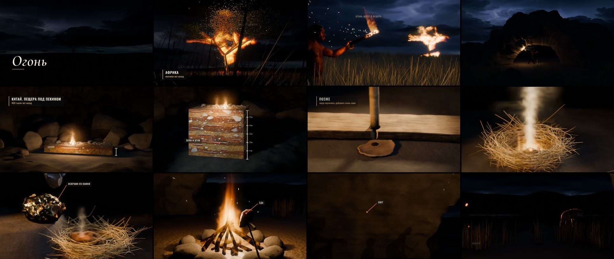

# 03 Fire

A 70.8-second clip (1920x1080, 24 fps, 1699 frames after dissolves) in nine shots: lightning sets an acacia on fire
(A1, A2), a firebrand is carried through the grass and kept alive in a cave through day and night (B1, B2), a cave near
Beijing in section with 6 m of deposits and hearth lenses (C), fire by friction and by flint on pyrite in macro
(D1a, D1b, D2), and the campfire at the cave entrance: food, warmth, light, protection, as a hyena backs into the dark (E).

| Part | Scripts |
|---|---|
| simulations | `sim_koster.py`, `sim_derevo.py`, `sim_golovnya.py`, `sim_trut.py`, `sim_dymok.py` (Mantaflow bakes), `sglazhivanie.py` (optional flame-grid smoothing) |
| shared helpers | `obshchee.py` (engine, fire materials, volumes from caches, seamless campfire loop, flickering lights), `obshchee_a.py`, `obshchee_b.py` |
| geometry | `kamni.py` (rocks, cave, branches, picture cards), `priroda.py` (acacia, grass with wind, ground, lightning), `iskry.py` (sparks with trails) |
| shots | `scena_a.py` .. `scena_e.py`; scene C and D were built with sub-agents under review |
| render | `ochered.sh` (one shot at a time, resumable) |
| edit | `montazh.py` (dissolves, flame smoothing for EEVEE volume hatching, glow, rain, captions, measuring rod) |
| audio | `lib/narration.mjs` (groups), `golos_raskladka.py`, `zvuki.mjs` (10 ElevenLabs sound effects), `muzyka_drama.py`, `dorozhka.py` |
| probes | `proba_kostra.py`, `proba_ogon.py`, `proba_vol.py` (quick Blender experiments kept for reference) |

The 9 shots (1815 frames) rendered in about 2 hours in one queue on an RTX 3060. The sky, hyena and figure cards are
Higgsfield pictures and are not part of this repository.

Run: `./run.sh 03 sim`, then `./run.sh 03 render`, `voice`, `edit` (see `./run.sh help`).
