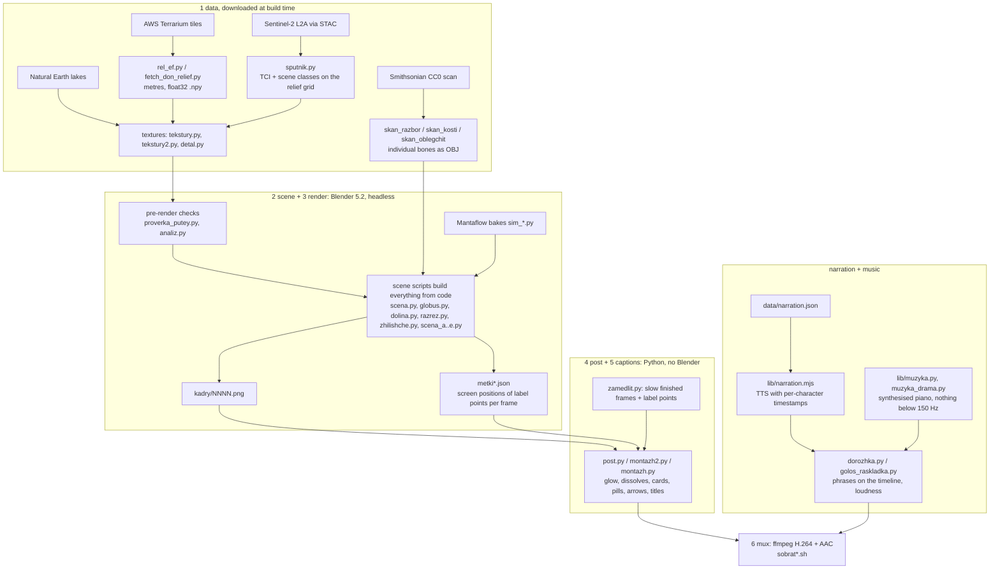

# Pipeline: data -> scene -> render -> post -> captions -> mux

Every clip follows the same six steps. Each step is a plain script with a `<root>` argument (the clip's working folder,
`work/<clip>/` by default), so steps can be rerun one by one and their outputs inspected on disk. `run.sh` strings
them together; the stage names below are the ones it accepts.

## 1. Data

| Clip | Script | Source | Output |
|---|---|---|---|
| 01 | `rel_ef.py` | AWS Terrarium tiles z5 (1024 tiles; `TERRARIUM_ZOOM=3` for a preview) | `dannye/rel_ef_8192.npy`: whole-Earth relief, equirectangular 8192x4096, metres |
| 01 | `fetch_lakes.py` | Natural Earth 1:10m lakes GeoJSON | `dannye/ne_10m_lakes.geojson` |
| 02 | `fetch_don_relief.py` | Terrarium z12, tiles x 2489-2495, y 1361-1367 | `dannye/rel_ef_don.npy`: 1792x1792, ~24 m per pixel |
| 02 | `sputnik.py` | Sentinel-2 L2A, 2025-08-30, Element84 STAC on AWS, read with rasterio over HTTP range requests | `sputnik/tci-*.png` (7168^2 true colour), `sputnik/scl-*.png` (scene classes) on the same Web Mercator grid as the relief |
| 02 | `fetch_mammoth_scan.py` | Smithsonian NMNH woolly mammoth, CC0, ~646 MB zip / 2.9 GB OBJ | `skan/mammoth-master_model.obj` |

Measured on 2026-11-20 in this repo: `rel_ef.py` and `fetch_don_relief.py` rebuilt `rel_ef_8192.npy` and `rel_ef_don.npy`
bit for bit identical to the grids used for the production renders, and `fetch_lakes.py` fetched a byte-identical GeoJSON.

## 2. Scene

Scenes are built from an empty factory-startup Blender by Python only: meshes through `bmesh` or `foreach_set` on numpy
arrays, materials as node trees, animation as keyframes or as a per-frame state function. Notable constructions:

- **Globe (01, 02/A).** A custom UV sphere with UV = (longitude, latitude) so the 8192x4096 textures and the markers agree
  to the pixel; relief as a Displace modifier fed by a 16-bit height map (sea floor compressed 10x). Migration paths are
  Chaikin-smoothed great-circle arcs drawn by animating `bevel_factor_end`; arcs fade at the visible disc edge using the
  altitude-aware threshold `dot < sqrt(1 - 1/r^2)`, otherwise they stick out as "hooks" beyond the limb.
- **Valley (02/B, E).** A 24 m grid over 43x43 km with a hole for a 14x14 km detail patch on an 8 m grid. Small relief
  that the data does not resolve (rills along the flow direction via line integral convolution, hummocks, chalk outcrops,
  snow drifts) is synthesised and faded to zero at the patch border, so there is no seam. About 250 thousand Ice Age trees
  are vertex instances on point clouds placed from the satellite forest mask, only on gully floors and along the floodplain.
- **Section (02/S, 03/C).** A museum-diorama block: per-vertex colour and real relief on a dense face mesh, wavy layer
  boundaries, finds embedded in the wall. Clip 02 shows a schematic 17-layer section of Kostenki 14 with the volcanic ash
  layer thickened and labelled as such; clip 03 grows 0.6 -> 6 m of deposits with hearth lenses while campfires relay.
- **Dwelling (02/H).** Bones cut out of the CC0 scan (skulls, mandibles, tusks, long bones), decimated, then placed by
  rules from the excavation brief: a ~9 m ring, skull pairs as the wall base, long bones as posts and ties, upturned
  mandibles along the outer edge, a hearth inside, the hypothetical hide roof semi-transparent with a cut-out.
- **Fire (03).** Mantaflow gas simulations baked once (`sim_*.py`), then opened as VDB volumes; a campfire is a seamless
  loop of two volumes half a period apart with crossfaded emission. Sparks are numpy particle trajectories with a mesh
  rebuilt per frame.

## 3. Render

`blender -b --factory-startup --python <scene>.py -- <root> <vse | 1,50,120-130 | metki> [--proba]`

- `vse` renders every frame and skips frames that already exist, so an interrupted render resumes.
- `metki` only writes the label points JSON (seconds instead of minutes), which is how captions are iterated.
- `--proba` is the preview path: 50% resolution, fewer samples, coarser meshes (clips 02 and 03 write these frames to
  `proba/<scene>` or `kadry/<shot>-proba`); every edit script upscales half-size frames to 1080p before drawing graphics.
- Clip 03 renders through `ochered.sh`: strictly one shot at a time, at lowered process priority, with an error count
  per shot. All motion of scene C is a function of the frame number (`postavit(n)`), so frames can render in any order.

Smoke test run on 2026-11-20 in this repo (Blender 5.2.3 LTS, RTX 3060): `./run.sh 01 smoke` built the globe scene from
freshly downloaded data, wrote marker positions for all 2070 frames and rendered three half-resolution frames, then the
label pass drew the cards on them; 74 s end to end. The result next to the production frames is in
[media/smoke-vs-production.jpg](media/smoke-vs-production.jpg).

## 4. Post and 5. captions

Text is never rendered in Blender. Each scene exports, for every frame, the screen position of every label point
(`world_to_camera_view`), plus extras such as whether a point faces the camera, the disc radius of the globe and the
position of each path head. The edit scripts (Pillow + OpenCV) then draw:

- cards with portraits, "frosted glass" plates, pills that ride with their point, arrows that draw themselves;
- everything with sub-pixel placement (bilinear warp, `cv2.LINE_AA` with `shift=4`), because whole-pixel steps made
  labels visibly tremble in the first version;
- glow on bright areas, dissolves between scenes, rain streaks, fades to black where place and time change.

Because captions are a separate pass, their wording and timing can change without re-rendering. When a reviewer asked
for more reading time on the section scene, the finished frames were slowed instead: `zamedlit.py` interpolates new
frames with `ffmpeg minterpolate` (motion compensated) and remaps the label points with the same time function
(`lib/captions.retime_map`). Scene S went from 15 to 23 s, H from 16 to 20 s (frames 331-480 at 1.8x), D2 from 14 to
16.8 s. `tests/test_captions.py` checks that these numbers match the scene lengths in the edit.

`podpisi_spisok.py` lists every caption with its on-screen time against a reading-speed rule for 10-11 year olds
(9 characters per second + 0.8 s) and makes snapshot sheets for the reviewers.

## Narration and music

- `data/narration.json` holds the narrator text with stress marks for the TTS, the planned start of every phrase and
  the measured length of the recorded take. `lib/narration.mjs` requests ElevenLabs speech with per-character
  timestamps and caches every response by a hash of voice + text, so unchanged phrases cost nothing.
- Clips 01 and 02 record one phrase per request and place phrases at fixed starts (`dorozhka.py`); clip 03 records
  groups of sentences for a connected intonation and cuts them at the quietest point between sentences
  (`golos_raskladka.py`), pushing a phrase later if it would overlap.
- Card and caption times in clip 01 follow the word timestamps of the take (`data/word_timings.json`).
- Music is synthesised in numpy (`lib/muzyka.py`, `muzyka_drama.py`): soft piano, a high-pass at 150 Hz so there is no
  drone, and in clip 03 ducking by 4 dB under the voice. Voice is normalised to -16 LUFS by ffmpeg `loudnorm`.

## 6. Mux

`sobrat.sh` / `sobrat2.sh` run the edit in 4 parallel workers and encode H.264 + AAC with `+faststart`: a high-quality
master and a lighter web version (crf 23, or two-pass at 1850 kbit/s for clip 02).

## What is not reproducible from this repository alone

| Missing input | Needed for | Why it is not here |
|---|---|---|
| Higgsfield pictures for clip 02 (camp, finds, figurine) with depth maps and BiRefNet masks | scenes C, D1, D2 | AI-generated images, ~37 MB; the scripts (`sloi.py`, `proekciya2.py`) are included |
| Higgsfield sky, hyena and figure cards for clip 03 | scenes A, B, E | AI-generated images, ~46 MB |
| Mammoth scan | clip 02 dwelling | 646 MB download from the Smithsonian; `fetch_mammoth_scan.py` takes the link |
| ElevenLabs voice and sound effects | narration and effects | paid API; text and timings are in `data/` |
| Rendered frames, caches, simulation bakes | everything | 6 to 34 GB per clip |

The species portraits of clip 01 are included in `clips/01-out-of-africa/data/portraits/` at the size the cards use, so
clip 01 can be rebuilt end to end; without portraits `post.py` draws neutral placeholder tiles.
